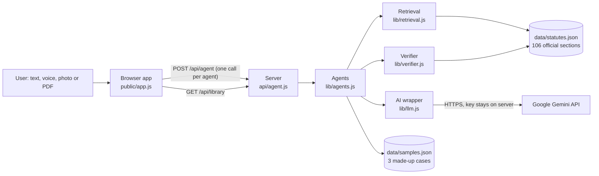
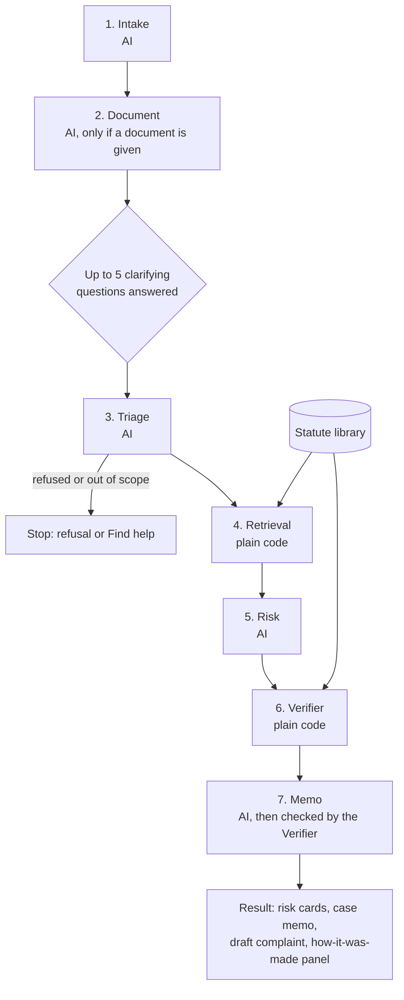

# Architecture

AinBondhu is a small web app with no framework and no database. The browser runs the case flow and calls a stateless server once per agent. The server holds the AI key, the statute library and the agents. Two of the seven agents, Retrieval and Verifier, are plain code with no AI, so the model cannot talk its way past them.

## System overview

## The seven agents

The Document agent runs before Intake in practice, so Intake can ask questions about the document. The progress trail in the app shows the agents in their numbered order.

| # | Agent | Uses AI | Input | Output |
|---|---|---|---|---|
| 1 | Intake | Yes | User text, extracted document | One-sentence summary, input style (Bangla, English, Banglish), 0 to 5 questions |
| 2 | Document | Yes (reads images and PDFs) | Photo, PDF or text of a document | Document type, parties, amounts, dates, obligations |
| 3 | Triage | Yes | Case so far | Issue type or "out of scope", urgency, unknowns, refusal flag |
| 4 | Retrieval | No | Issue type and all case text | Up to 7 statute sections, always including core sections for the issue |
| 5 | Risk | Yes | Case and the retrieved sections | 3 to 6 risks, each with a citation id or none, an exact quote, a confidence level |
| 6 | Verifier | No | Risks and the retrieved ids | Risks that survive checking, a list of what was removed and why |
| 7 | Memo | Yes, then verified | Case, verified risks, cited sections | Summary, facts, next steps, editable draft complaint |

## Trust boundaries

| Boundary | Rule |
|---|---|
| AI key | Read only on the server from an environment variable; never sent to the browser |
| User text and documents | Treated as data. Prompts tell every agent to ignore instructions written inside them |
| AI output to the browser | Every field is cleaned on the server (types, lengths, allowed values), and every value is HTML-escaped in the browser |
| Law | Only the statute library counts. The AI may cite an entry only if Retrieval supplied it for this case |
| Storage | None. No database, no accounts, no logs of case text. Uploaded files exist only for the request |

## Why Retrieval and Verifier are plain code

The core promise is that every legal statement can be traced to official text. If an AI model chose the law and checked its own citations, a single confident mistake would pass straight to the user. Keeping Retrieval and Verifier as ordinary code makes them predictable, testable (they have their own tests) and impossible to persuade.

What the Verifier checks:

1. The cited section exists in the library.
2. The cited section was supplied by Retrieval for this case.
3. The quoted words appear in the section's text (after normalising Unicode, Bangla digits and Bangla number words).
4. Every sentence that mentions a section number, an Act and year, a time limit or a court is supported by the cited section. Unsupported sentences are removed.
5. The same sentence check runs on the Memo agent's summary, facts, next steps and draft.

Everything removed is listed in the "How this answer was made" panel.

## Handling failure

| Situation | What happens |
|---|---|
| AI model busy (503), rate-limited (429) or server error (500) | Wait 1.5 seconds and retry once, then try the next model |
| AI model slow (no answer in 25 seconds) or retired (404) | Move to the next model straight away |
| Whole step takes more than 50 seconds | Stop and show "The AI service is busy or slow right now" |
| AI fails on a sample case | Show the sample's prepared output, labelled as such |
| No AI key configured | Demo mode: sample cases work; free-text cases show a clear message |
| Case outside the three issue types | Triage marks it out of scope; the user is sent to Find help |
| Request for fraud, harassment, forgery or evidence tampering | Triage refuses; no further agents run |

Model order: `gemini-3.5-flash-lite`, then `gemini-3.1-flash-lite`, `gemini-3.7-flash`, `gemini-3.6-flash`. All are configurable.

## Deployment

The same code runs locally and on Vercel:

- **Locally:** `server.js` serves `public/` and the two API routes. `start-ainbondhu.bat` starts it on Windows.
- **On Vercel:** `public/` is served as static files and `api/*.js` as serverless functions (60-second limit, which is why each step is capped at 50 seconds).

## Scaling notes

- The server is stateless, so it scales horizontally without changes.
- Each case makes five AI calls (four if there is no document). Cost and latency grow with cases, not with the size of the statute library, because Retrieval sends at most 7 sections to the model.
- Adding an issue type or an Act is a data change (`data/issue-types.json`, `scripts/import-bdlaws.js`), not a code change.
