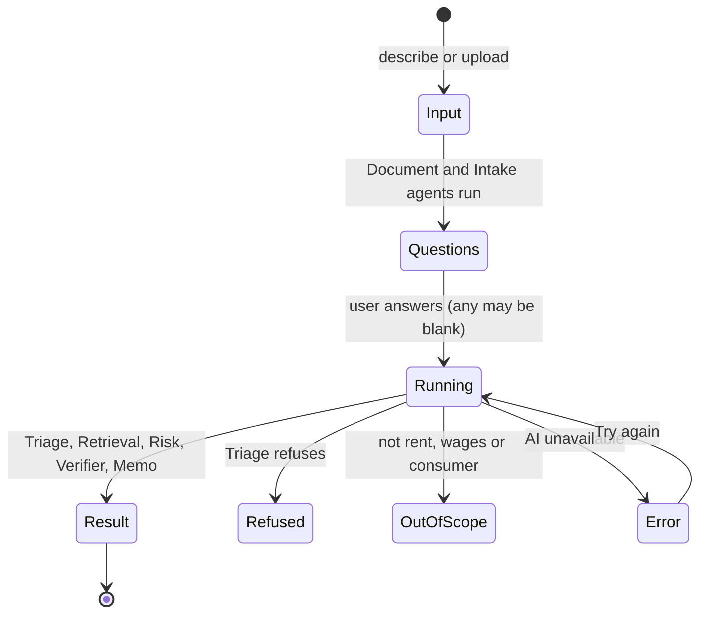

# Frontend

The frontend is a single page written in plain HTML, CSS and JavaScript with no framework and no build step. It is mobile-first, bilingual (English and Bangla), and works on slow connections.

## Files

| File | Purpose |
|---|---|
| `public/index.html` | Page shell; loads the stylesheet and scripts |
| `public/styles.css` | All styles, including print styles for the case memo |
| `public/i18n.js` | Every interface string in English and Bangla, plus the About and Partners page content |
| `public/app.js` | Router, pages, case flow, calls to the API |

## Pages

The router reads the part of the address after `#`.

| Address | Page |
|---|---|
| `#home` | Introduction, "Describe your problem" and "Upload a document", issue types, sample cases |
| `#case` | The case flow (below) |
| `#samples` | The three made-up sample cases, each with its sample document |
| `#how` | Diagram of the seven agents and the statute library |
| `#library` | The statute library, grouped by Act, with official text, source links and check status |
| `#help` | Find help: legal-aid placeholders marked "verify before use", and what to bring |
| `#impact` | Impact dashboard, labelled "Demo data" |
| `#partners` | For legal-aid partners, with the pricing outline |
| `#about` | Limits, privacy, responsible-AI policy, data and model sources |

## The case flow

1. **Input.** A text box with a Speak button, and an optional document upload. Sample cases fill these in.
2. **Questions.** Shows what was understood, the extracted document terms, and up to 5 questions. In demo mode, sample cases pre-fill the prepared answers. With live AI, the AI writes its own questions, so they start blank and the sample's facts are sent to the AI as separate question-and-answer pairs.
3. **Running.** A progress trail shows each agent as Waiting, Working, Done, Not needed or Stopped.
4. **Result:**
   - Issue type and urgency, with what is still unknown.
   - Time limit card: the time limit from the official section if one was retrieved, otherwise "check the time limit with a legal aid provider".
   - Risk cards: what it says, why it matters, the cited section with its exact quote (or "practical risk: no verified provision"), and a confidence level.
   - Case memo: summary, facts, risks, cited provisions with their official text, evidence to gather, next steps, and an editable draft message.
   - Download as PDF (the browser's print dialog, with print styles showing only the memo) and Copy draft.
   - "How this answer was made": whether live AI or prepared sample output was used and which model, the agents that ran, the sections retrieved and why they matched, and everything the Verifier removed and why.
   - "Was this helpful?" rating.

## Language

- A button in the header switches between English and Bangla. The choice is remembered in the browser.
- The language chosen when a case starts is the language of the AI's answers. If the user writes in Banglish, answers come in Bangla script.
- The law itself is shown in official Bangla. In English mode a note explains that the official text is in Bangla and the result explains it in English.
- The page's `lang` attribute follows the language, so screen readers pronounce text correctly.

## Input features

- **Voice:** the browser's speech recognition, set to Bangla (`bn-BD`) or English. It works in Chrome and Edge; other browsers show a message.
- **Photos:** resized in the browser to at most 1600 pixels and compressed as JPEG before upload, to keep uploads small on slow connections.
- **PDFs:** sent as they are, up to about 3 MB.

## Safety in the interface

- All text from the AI or the user is HTML-escaped before display, so a model or document cannot inject page content.
- Links from the statute library are shown only if they start with `http://` or `https://`.
- Demo mode and fallback output carry visible banners; prepared output is never presented as live AI.
- "General information, not legal advice" appears at the top of every page, in the footer and on the memo.

## Accessibility

- Skip-to-content link; focus moves to the main content when the page changes.
- The progress trail is announced to screen readers as it updates.
- Large text (18 px base), high-contrast colours, buttons at least 40 to 48 px tall.
- The pulsing progress animation is turned off for users who prefer reduced motion.

## Offline preview

`node scripts/build-preview.js` builds `dist/preview.html`, one self-contained file that runs the whole interface without a server. The sample cases show prepared output, while Retrieval and Verifier run for real in the browser. See [simulation_engine.md](simulation_engine.md).
